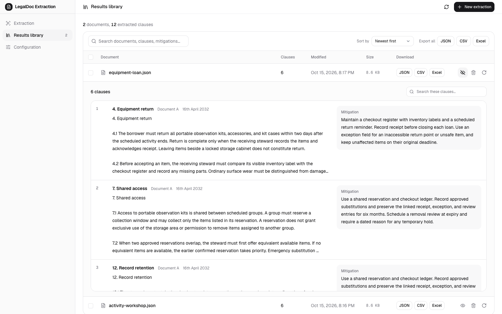
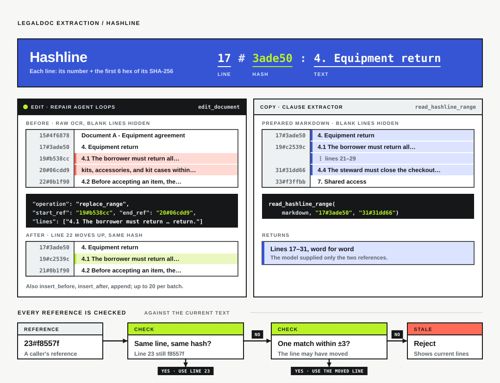
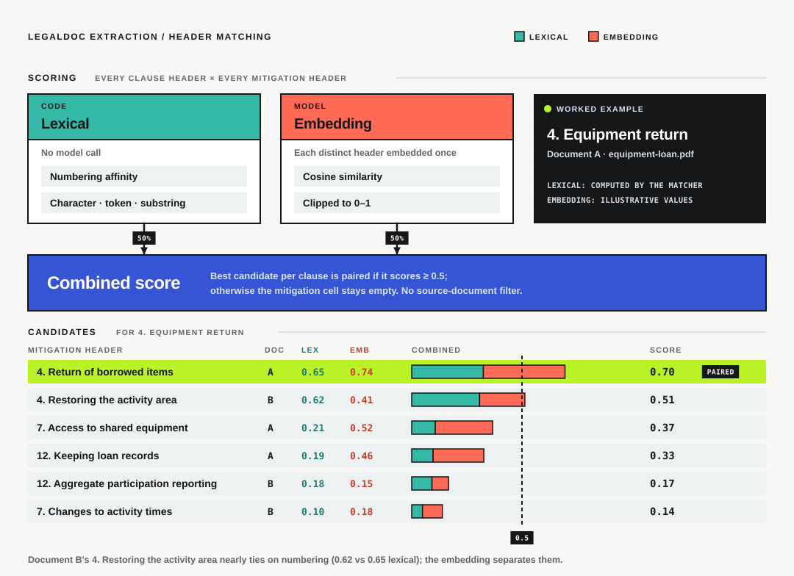
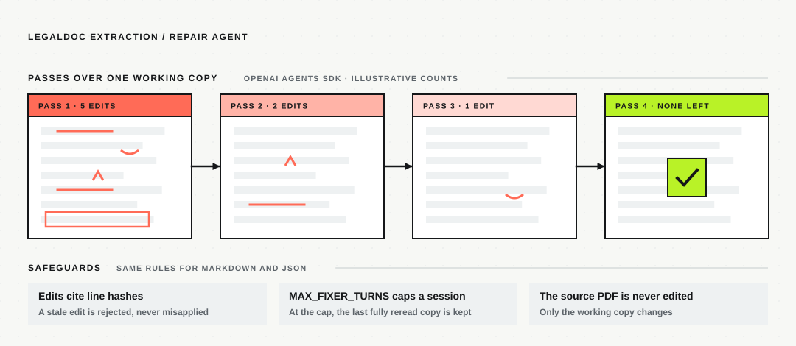

# LegalDoc Extraction

> [!NOTE]
> **Cleaned public edition.** This is a sanitized copy of an internal project whose documents, client, templates, and prompts are confidential.
> Names, section headings, prompts, and sample PDFs are replaced with placeholders such as `Document A` and `Mitigation 1`.
> The engineering is unchanged: the same workflows, agents, extraction, matching, and app.

Turns scanned legal PDFs into one row per clause, each paired with the mitigation that governs it, and exports the rows as JSON, CSV, or Excel.



## How it works

Two LangGraph workflows run per PDF: the **loader** turns pages into clean Markdown, and the **extractor** turns Markdown into rows.
Every model step is followed by a code check before its output is kept.


### Hashline

Every edit and every copy addresses lines as `LINE#HASH`, so a model can say *where* without rewriting *what*.
The repair agents edit through it; the clause extractor copies clause text through it.



### Header matching

Each clause is paired with a mitigation by comparing headers: half lexical similarity, half embedding similarity, across every source document.



### Repair agent

Both repair steps run one OpenAI Agents SDK agent over a working copy, through hash-addressed `read_document` and `edit_document` tools.



Extraction runs in the backend, survives a closed browser, and stops at the next safe point on **Stop extraction**.
**Re-extract** reruns a result from its cached Markdown without repeating OCR.

## Quick start

Requires Python 3.13+, uv, Node.js 22.12+, and pnpm.

```bash
uv sync
pnpm --dir frontend install
```

Create `.env`:

```dotenv
PLATFORM="Vercel AI Gateway"
AI_GATEWAY_API_KEY="your-api-key"
LLM="openai/gpt-5.6-luna"
EMBEDDING_MODEL="google/gemini-embedding-2"
AUTH_ENABLED=false
```

```bash
bash start.sh
```

Open [localhost:5173](http://localhost:5173), pick models in **Configuration**, upload PDFs in **Extraction**, and review or download in **Results library**.
On Windows, run `.\start.ps1`.
Sample PDFs and what they test are in [`examples/`](examples/README.md).

## Configuration

| `PLATFORM` | Credentials |
| --- | --- |
| `Vercel AI Gateway` | `AI_GATEWAY_API_KEY` |
| `Gemini` | `GEMINI_API_KEY` |
| `Custom` (OpenAI-compatible) | `LLM_BASE_URL`, `LLM_API_KEY` |

`LLM` needs image input, structured output, and tool calling; `EMBEDDING_MODEL` is used for header matching.

| Setting | Range | Default |
| --- | --- | --- |
| `PAGES_PER_CHUNK` | 1–5 pages per OCR request | 3 |
| `MAX_CONCURRENCY` | 1–5 | 3 |
| `MAX_FIXER_TURNS` | 3–30 turns per repair session | 30 |

Login is on by default and uses Keycloak (`KEYCLOAK_BASE_URL`, `KEYCLOAK_REALM`, `KEYCLOAK_CLIENT_ID`); `AUTH_ENABLED=false` turns it off for local use.
LangSmith tracing is off unless `LANGSMITH_TRACING=true`.

## Other ways to run

```bash
uv run python -m legaldoc_extraction.main      # batch-process PDFs in data_input/
docker compose up --build                      # app and API on localhost:8000
```

The background runner is process-local, so run one app process and expect a restart to interrupt an active extraction.

## Development

Backend in `src/legaldoc_extraction/` (FastAPI), frontend in `frontend/` (Preact, Vite); frontend API types are generated from the backend schemas.

```bash
pnpm run build                          # regenerate API types and build the frontend
uv run ruff check src
pnpm --dir frontend exec tsc --noEmit
```
